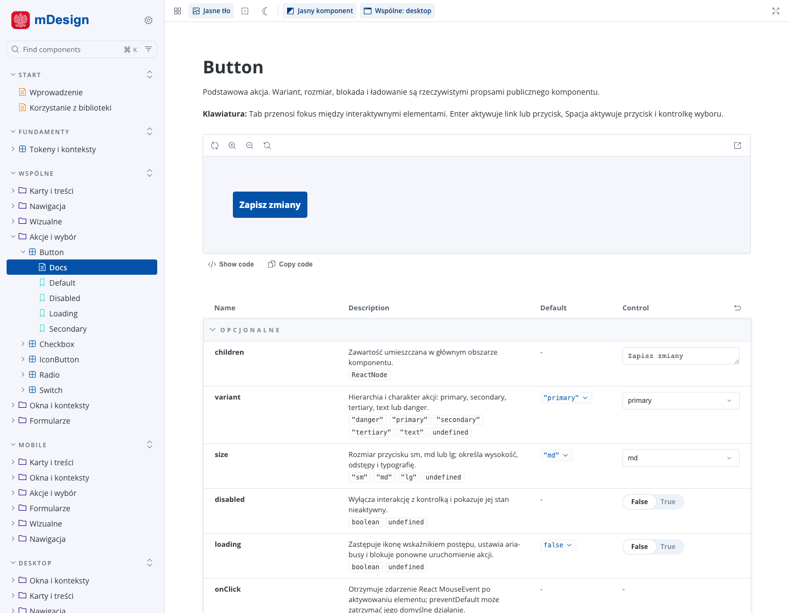
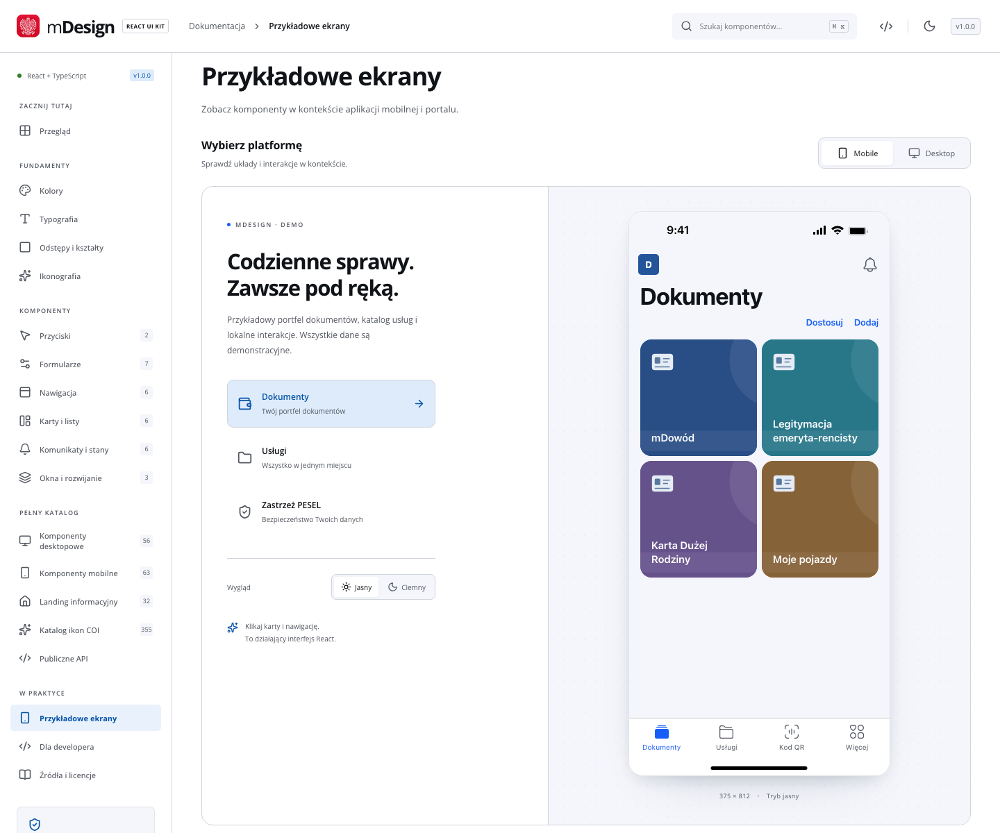

[Polski](README.md) | [English](README.en.md)

<p align="center">
  
</p>

# mDesign React: UI kit inspirowany aplikacją mObywatel

Niezależna biblioteka React i TypeScript inspirowana systemami interfejsu aplikacji
mObywatel, portalu i strony informacyjnej. Zawiera komponenty oraz dokumentację
Storybook. Własny kod jest na licencji [MIT](LICENSE).

To nieoficjalny, niezależny projekt. Nie jest powiązany z Ministerstwem Cyfryzacji ani Centralnym Ośrodkiem Informatyki.

## Playground online

**[Otwórz Storybook →](https://slominskiwiktor.github.io/mdesign-react/)**

Przeglądaj komponenty, zmieniaj ich właściwości w **Controls**, przełączaj motyw
i szerokość ekranu oraz kopiuj kod przykładów. Nie potrzebujesz instalacji ani konta.
[Pełne przykładowe ekrany](https://slominskiwiktor.github.io/mdesign-react/showcase/#screens)
pokazują komponenty w kontekście aplikacji.

[Wiki](https://github.com/slominskiwiktor/mdesign-react/wiki) ·
[Wydania](https://github.com/slominskiwiktor/mdesign-react/releases) ·
[Dokumentacja pracy](docs/DEVELOPMENT.md) ·
[Issues](https://github.com/slominskiwiktor/mdesign-react/issues)

## Podgląd





## Uruchomienie

Wymagane: Node **22.23.3** z `.nvmrc` oraz Bun **1.4.4**.

```sh
git clone https://github.com/slominskiwiktor/mdesign-react.git
cd mdesign-react
bun install --frozen-lockfile
bun run dev
```

Storybook: **http://localhost:5173**.
Samodzielny showcase z HMR uruchomisz przez `bun run dev:showcase` na porcie 5174.
Instrukcja pracy i testów: [docs/DEVELOPMENT.md](docs/DEVELOPMENT.md).

## Co zawiera

- **186 komponentów React:** 35 wspólnych, 63 mobilne, 56 portalu i 32 landingu.
- Trzy osobne systemy wizualne: geometria mobilna, portal z Open Sans i landing z Lato.
- Controls, opisy propsów, przykłady kodu oraz 308 historii Storybooka.
- Tokeny JSON, DTCG i CSS, motywy web/mobile oraz komponenty formularzy, dialogów i nawigacji.
- Ikony, fonty i gotowe kompozycje ekranów.

[Lista komponentów](docs/COMPONENT-COVERAGE.md) · [Tokeny](docs/TOKENS.md)

## Użycie w aplikacji

Pobierz [paczkę TGZ z wydania 1.0.0](https://github.com/slominskiwiktor/mdesign-react/releases/tag/v1.0.0)
i zainstaluj ją w aplikacji:

```sh
npm install ./mdesign-react-1.0.0.tgz
```

Możesz też zbudować paczkę z bieżących źródeł:

```sh
bun run pack:lib
```

Archiwum TGZ powstaje w `artifacts/current/`. Pakiet nie jest obecnie publikowany w rejestrze npm.

```tsx
import { Button, Card, TextField } from '@mdesign/react';
import '@mdesign/react/styles.css';

export function Example({ onContinue }: { onContinue: () => void }) {
  return (
    <div data-platform="web" data-theme="light">
      <Card title="Dane demonstracyjne">
        <TextField label="Imię" autoComplete="given-name" />
        <Button type="button" onClick={onContinue}>
          Kontynuuj
        </Button>
      </Card>
    </div>
  );
}
```

Dostępne punkty importu: `@mdesign/react`, `/mobile`, `/portal`, `/landing` i `/icons`.
Style importuj jawnie przez `@mdesign/react/styles.css`. Komponenty landingu
umieszczaj w `LandingProvider`; wspólne komponenty mobilne w kontekście
`data-platform="mobile"`. Obsługiwany React: 18.3.1 i 19.x.

`data-theme="light"` i `data-theme="dark"` wybierają motyw wspólnych komponentów.
Landing zachowuje własną jasną paletę. Routing, backend i dane dostarcza aplikacja.

## Testy i build

```sh
bun run verify
bun run test:coverage
bun run -- playwright install chromium
bun run test:browser
bun run test:stories
bun run build
```

`verify` sprawdza lint, formatowanie, typy, tokeny, narzędzia, mapy API i testy
jednostkowe. Testy Chromium i coverage są oddzielnymi kontrolami. Build tworzy
`dist/showcase`, `dist/storybook` i `dist/lib`.

## Licencje

Własny kod mDesign: [MIT](LICENSE) © 2026 Wiktor Słomiński.

Natywne ikony pochodzące z COI: © 2025 Centralny Ośrodek Informatyki,
licencja MIT. Zachowujemy [tekst licencji COI](src/kit/native-icons/LICENSE-COI-MIT-PL.txt)
oraz [metryki i źródła materiałów](docs/REFERENCES.md), w tym
[repozytorium źródłowe mObywatela](https://github.com/fajfer/mObywatel).
Zmodyfikowane i zastępcze zasoby demonstracyjne są oznaczone w metrykach pochodzenia.

Fonty, ikony i zależności zachowują własne licencje opisane w
[THIRD_PARTY_NOTICES.md](THIRD_PARTY_NOTICES.md).

Problemy i propozycje zmian zgłaszaj w [Issues](https://github.com/slominskiwiktor/mdesign-react/issues).
